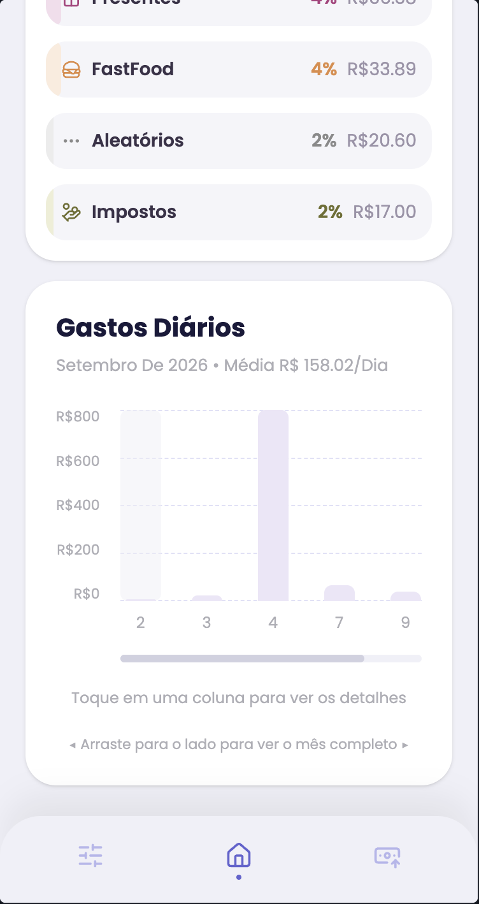
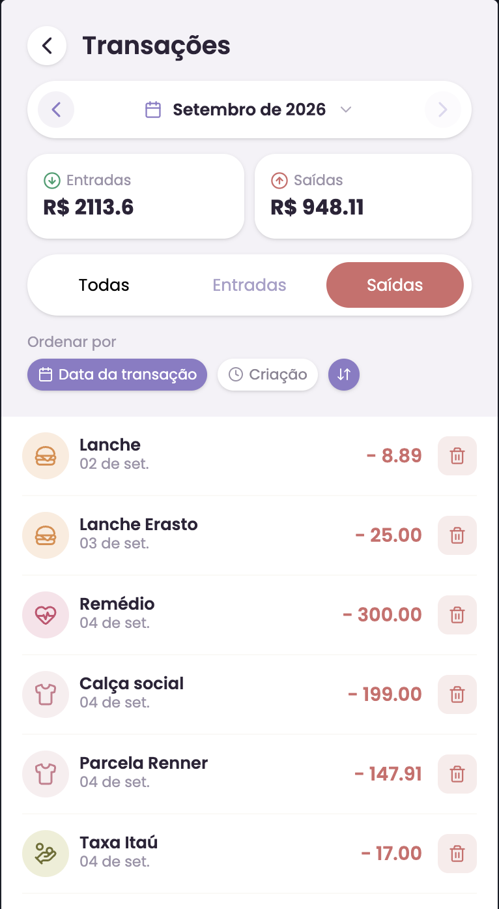

# SePoupe

Controle financeiro pessoal, para uso individual ou compartilhado entre duas pessoas de confiança (por exemplo, um casal). Nasceu de um problema simples: eu precisava enxergar para onde meu dinheiro estava indo, e não queria depender de planilha nem de app cheio de funcionalidade que eu nunca ia usar.

O projeto está em produção, sendo usado de verdade no dia a dia.

## Índice

- [O que o app faz](#o-que-o-app-faz)
- [Como funcionam as contas](#como-funcionam-as-contas)
- [Escopo do v1](#escopo-do-v1)
- [Stack](#stack)
- [Como rodar localmente](#como-rodar-localmente)
- [Variáveis de ambiente](#variáveis-de-ambiente)
- [Roadmap](#roadmap)
- [Licença](#licença)

## O que o app faz

- Lançamento de transações (entrada e saída), com categoria, método de pagamento (PIX, Débito, VA, Crédito, Cheque ou Dinheiro) e data
- Categorias com ícone e cor; novas categorias (de entrada ou de saída) podem ser criadas direto na tela de nova transação
- Dashboard com resumo do mês: total gasto, total com acertos e saldo disponível
- Ranking de gastos por categoria e gráfico de gastos diários
- Listagem de transações com filtro por tipo, ordenação e navegação por mês
- Controle de saldo de cartão de crédito, cheque especial e vale-alimentação
- Tela de Capital: patrimônio total (conta corrente + poupança), com opção de investir (conta corrente para poupança) e resgatar (poupança para conta corrente)

## Como funcionam as contas

O sistema entende cinco tipos de conta:

- **Cartão de crédito**: tem um limite. Cada compra no crédito aumenta o valor usado. Pagar a fatura reduz esse valor de volta, e o pagamento da fatura **não conta como um gasto novo**, porque o gasto já foi registrado no momento da compra. Contar os dois seria duplicar o valor.
- **Cheque especial**: funciona do mesmo jeito que o cartão de crédito: tem limite, e o uso aumenta o valor devido. Quitar reduz.
- **Vale-alimentação (VA)**: diferente dos outros dois, não tem limite fixo. É uma carteira: o crédito do vale (uma entrada na categoria "VA") aumenta o que está disponível, e cada compra paga com VA reduz.
- **Conta corrente**: alimentada pelas transações pagas em PIX, Débito ou Dinheiro. Entradas somam ao saldo; saídas e acertos subtraem.
- **Poupança**: só se movimenta pela tela de Capital. Investir tira da conta corrente e coloca na poupança; resgatar faz o caminho inverso. Não dá para investir mais do que há na conta corrente, nem resgatar mais do que há na poupança.

Essa distinção existe porque, sem ela, o total de gastos do mês fica errado: pagar uma fatura de cartão não é um gasto a mais, é a liquidação de gastos que já aconteceram antes. O sistema separa isso automaticamente com um tipo de transação chamado "acerto", que atualiza o saldo da conta sem contar como gasto no resumo do mês. No Dashboard, o saldo disponível é entradas menos saídas, e os acertos aparecem num card separado ("Total com acertos", que soma gastos e acertos).

## Escopo do v1

Este é um projeto pessoal, com escopo definido conscientemente:

- **Entrada de transações é 100% manual.** Não há integração bancária automática (Open Finance) nesta versão.
- **Não há isolamento de dados entre usuários.** Todos os usuários cadastrados no sistema compartilham as mesmas transações e contas. O objetivo é um financeiro compartilhado (ex: casal), não um sistema multiusuário isolado por família.
- **Sem edição de transação.** Corrigir um lançamento errado hoje significa apagar e criar de novo.

Essas decisões, e o que está planejado para versões futuras (multi-usuário isolado, integração bancária, categorização automática), estão documentadas em [ROADMAP.md](./ROADMAP.md).

## Stack

**Backend**

- Node.js + Fastify
- PostgreSQL
- Autenticação via JWT em cookie httpOnly

**Frontend**

- React + Vite
- Tailwind CSS

**Infraestrutura**

- Deploy em VPS própria, com Nginx e PM2
- CI/CD via GitHub Actions

## Como rodar localmente

### Pré-requisitos

- [Node.js](https://nodejs.org) versão 24 ou superior
- [PostgreSQL](https://www.postgresql.org/download/) versão 16 ou superior

### Passo a passo

**1. Clone o repositório**

```bash
git clone https://github.com/lucasboeck06/sepoupe.git
cd sepoupe
```

**2. Instale as dependências**

```bash
npm install
cd frontend && npm install
cd ..
```

**3.1 Crie o banco de dados**

```bash
createdb sepoupe
psql -d sepoupe -f schema.sql
```

Isso cria todas as tabelas necessárias. O banco começa vazio: ainda não existe seed com contas e categorias iniciais (está planejado junto com as migrations, veja o [ROADMAP.md](./ROADMAP.md)).

**3.2 Crie as contas**

> **Atenção:** sem este passo, cartão, cheque especial, VA e a tela de Capital não funcionam. O saldo de cada conta é atualizado procurando a linha pelo `tipo`, então, se a linha não existir, a movimentação simplesmente não é registrada em lugar nenhum.

Abra o banco (`psql sepoupe`) e insira uma linha para cada tipo de conta, ajustando os nomes e os limites do cartão e do cheque especial para os seus:

```sql
INSERT INTO contas (nome, tipo, limite, saldo) VALUES
  ('Cartão de crédito', 'credito',         0,    0),
  ('Cheque especial',   'cheque_especial', 0,    0),
  ('Vale-alimentação',  'va',              0,    0),
  ('Conta corrente',    'conta_corrente',  NULL, 0),
  ('Poupança',          'poupanca',        NULL, 0);
```

Alguns cuidados:

- Insira **uma única linha por tipo**. Como a atualização é feita pelo `tipo`, duas linhas do mesmo tipo seriam alteradas juntas.
- O `limite` do VA precisa começar em `0`, e não em `NULL`: é ele que cresce a cada crédito do vale, e `NULL + valor` continua `NULL` no PostgreSQL.

As regras de conta também dependem de alguns **nomes de categoria** fixos no código (`backend/src/services/contaService.js`): uma entrada na categoria `VA` credita o vale, e acertos nas categorias `Fatura Inter` e `Fatura Caixa` abatem o cartão de crédito e o cheque especial, respectivamente. A tela do app só cria categorias de entrada e de saída, então as de acerto precisam ser inseridas no banco:

```sql
INSERT INTO categorias (nome, tipo, icone, cor_primaria, cor_secundaria) VALUES
  ('VA',           'entrada', 'circle-question-mark', '#a8a2b0', '#ececec'),
  ('Fatura Inter', 'acerto',  'circle-question-mark', '#a8a2b0', '#ececec'),
  ('Fatura Caixa', 'acerto',  'circle-question-mark', '#a8a2b0', '#ececec');
```

O ícone (qualquer nome da biblioteca [Lucide](https://lucide.dev/icons)) e as cores podem ser trocados à vontade; os valores acima são os mesmos que o app usa por padrão ao criar uma categoria.

**3.3 Crie o usuário**

A rota de criação de usuário exige autenticação, então o primeiro usuário
precisa ser inserido diretamente no banco.

- Gere uma senha criptografada (na raiz do projeto, depois do `npm install`):

```bash
node -e "console.log(require('bcrypt').hashSync('sua_senha_aqui', 10))"
```

Isso imprime um texto longo no terminal, algo como
`$2b$10$abc123...`. Copie esse texto inteiro.

- Abra o banco de dados que você criou no passo anterior:

```bash
psql sepoupe
```

Isso abre um terminal do próprio banco, com o prompt mudando para
algo como `sepoupe=#`.

- Cole o comando abaixo, substituindo os valores entre aspas
  pelos seus, e o hash pelo que você copiou no passo anterior:

```sql
INSERT INTO usuarios (nome, email, senha)
VALUES ('Seu Nome', 'seu-email@exemplo.com', 'COLE_O_HASH_AQUI');
```

- Saia do banco:

```sql
\q
```

Pronto: agora você pode logar no app com o e-mail e a senha que definiu.

**4. Configure as variáveis de ambiente**

Copie o arquivo de exemplo do backend (ele fica na raiz do projeto) e preencha com seus dados. É de suma importância que os dados do banco estejam corretos aqui, se não, não vai rodar:

```bash
cp .env.example .env
```

O `SECRET` precisa ter pelo menos 32 caracteres; sem isso, o servidor se recusa a subir. Dá para gerar um com:

```bash
openssl rand -hex 32
```

Copie também o do frontend:

```bash
cp frontend/.env.example frontend/.env
```

Veja a seção [Variáveis de ambiente](#variáveis-de-ambiente) para o que cada uma significa.

**5. Rode o backend**

Na raiz do projeto (o `.env` é lido a partir da pasta onde o comando é executado):

```bash
npm run dev
```

O `npm run dev` reinicia o servidor a cada alteração no código; para rodar sem isso, use `npm start`. O backend sobe na porta `3000`.

**6. Em outro terminal, rode o frontend**

```bash
cd frontend && npm run dev
```

**7. Acesse**

O frontend deve abrir em `http://localhost:5173`. Faça login com o e-mail e a senha que você definiu no passo 3.3.

## Screenshots

### Dashboard

<p align="center">
  
  
  
</p>

### Nova transação

<p align="center">
  
</p>

### Transações e login

<p align="center">
  
  
</p>

## Variáveis de ambiente

### Backend (`.env`)

| Variável      | O que é                                                                                                |
| ------------- | ------------------------------------------------------------------------------------------------------ |
| `DBUSER`      | Usuário do PostgreSQL                                                                                  |
| `DBHOST`      | Endereço do banco (geralmente `localhost`)                                                             |
| `DBPORT`      | Porta do banco (padrão `5432`)                                                                         |
| `DBNAME`      | Nome do banco criado no passo 3.1                                                                      |
| `DBPASS`      | Senha do usuário do banco                                                                              |
| `SECRET`      | Chave secreta usada para assinar o JWT; mínimo de 32 caracteres (gere com `openssl rand -hex 32`)      |
| `NODE_ENV`    | `development` localmente, `production` em produção                                                     |
| `CORS_ORIGIN` | Endereço do frontend (`http://localhost:5173` em desenvolvimento)                                      |

### Frontend (`frontend/.env`)

| Variável            | O que é                                                          |
| ------------------- | ---------------------------------------------------------------- |
| `VITE_API_BASE_URL` | Endereço do backend (`http://localhost:3000` em desenvolvimento) |

## Roadmap

A trajetória completa do projeto, decisões de arquitetura e o que vem a seguir estão documentados em [ROADMAP.md](./ROADMAP.md).

## Licença

Este projeto está sob a licença MIT; veja [LICENSE](./LICENSE) para mais detalhes.
